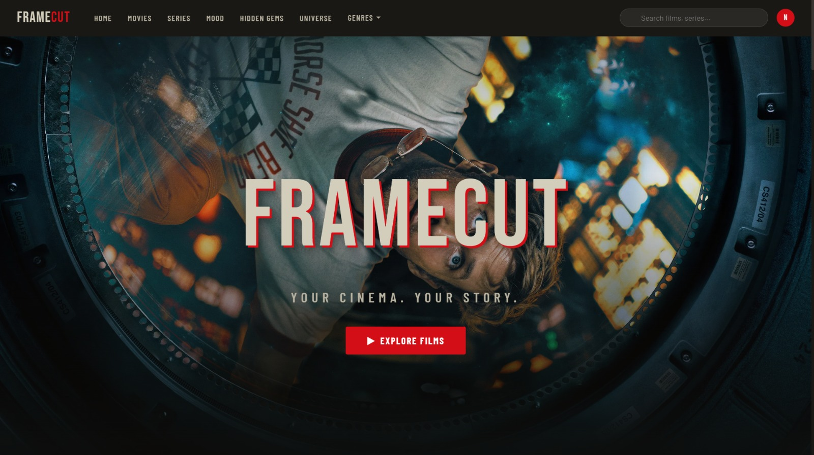

<h1 align="center">🎬 FrameCut: Your Cinema, Your Story</h1>

<p align="center">
  
</p>

<p align="center">
  <a href="https://framecut-kmem.onrender.com/"></a>
  
  
  
  
</p>

<p align="center">
  🌐 <strong>Official Website:</strong> <a href="https://framecut-kmem.onrender.com/">https://framecut-kmem.onrender.com/</a>
</p>

---

## 🌟 About FrameCut

**FrameCut** is a bespoke, full-stack cinema discovery platform and movie tracking diary designed for true film lovers. Inspired by streaming interfaces like **Amazon Prime Video** and social film platforms like **Letterboxd**, FrameCut combines rich visual media exploration with automated catalog synchronization and personal film journaling.

Operating as a live, fully responsive production web application, FrameCut features a sleek dark-mode glassmorphic interface, fluid micro-animations, and continuous data pipelines that keep thousands of titles, ratings, and cast networks up to date.

---

## 🍿 Platform Experience & Features

### 🎬 Prime Video-Style Hover Preview Cards
- **Seamless Interactive Portal:** Hovering over any movie or series tile smoothly expands into a prominent preview card complete with ambient backdrop blur, high-resolution key art, rating, genre badges, and overview synopsis.
- **Full-Card Clickability:** Clicking anywhere on the expanded card immediately launches the full title detail view for frictionless navigation.
- **Hardware-Accelerated Easing:** Powered by GPU-accelerated cubic-bezier curves (`cubic-bezier(0.2, 0.8, 0.2, 1)`) and soft fade transitions, eliminating stutter and abrupt layout shifts.

### 🎨 Radiant "Explore by Genre" Categories
- **Bespoke Visual Palettes:** Replaced generic tiles with dynamic, individualized radiant color themes for over 20 genres (Action crimson, Sci-Fi cyan, Animation magenta, Horror blood-red, Comedy amber, etc.).
- **Interactive Glyphs & Glow:** Ambient lighting and subtle micro-elevations sweep across cards on hover.

### ⚡ Sub-15ms Live Search
- **Instant Local Autocomplete:** Search queries check the indexed database first, returning matching titles and poster thumbnails in **5–15ms**.
- **Parallel Real-Time Discovery:** For newly released or regional films not yet in the local database, parallel non-blocking WebClient requests query TMDB in real time and store them on the fly.
- **Stale Request Cancellation:** Uses frontend `AbortController` and debounced event dispatching to ensure smooth, zero-latency typing.

### 📖 Personal Cinema Diary & Watchlists
- Rate films and television series on 5-star and 10-point scales.
- Write community reviews with built-in **Spoiler Warning Masks** that viewers can toggle to reveal.
- Curate and track a personalized cinema watchlist linked to user accounts.

### 🌌 The Cinematic Director Universe
- Dedicated hub to explore the filmographies of legendary directors (Christopher Nolan, Quentin Tarantino, Hayao Miyazaki, Karthik Subbaraj, and more).
- Visualizes recurring actor collaborations, career timelines, and directorial styles in an interactive network canvas.

### 🎭 Mood Matcher
- Personalized recommendation engine matching curated cinema selections to the viewer's current emotional vibe (*Thrilled*, *Emotional*, *Mind-Blown*, *Feel-Good*, *Nostalgic*).

### 🛡️ Production Security Architecture
- Dual credential authentication: sign in via either **Username or Email**.
- BCrypt password hashing with adaptive salt work factors.
- Secure session management with `HttpOnly`, `SameSite=Lax`, and SSL/TLS protection.
- Hardened against unauthorized privilege escalation and brute-force attacks.

---

## ⚙️ Automated Backend Architecture & Data Pipeline

```
 [User Browser] 
       │
       ▼
 [Spring Security Filter Chain] (BCrypt, Session Cookies, HTTPS)
       │
       ▼
 [Controllers] ──► [Service Layer] ──► [PostgreSQL Database] (Local Cache)
                          │
                          ▼ (Reactive WebClient)
                   [TMDB REST API]
```

- **Continuous 6-Hour Automated Synchronization:** A persistent background scheduler (`TmdbSyncScheduler`) runs every 6 hours, pulling the latest weekly trending cinema (`/trending/movie/week`, `/trending/tv/week`) and current theatrical/OTT releases (`/movie/now_playing`, `/tv/on_the_air`).
- **Persistent Database Sync State:** Catalog pagination progress is tracked directly in the PostgreSQL `sync_state` table, ensuring the ingest pipeline continuously advances and safely recycles without losing state across deployments.
- **Deterministic Infinite Scrolling:** Multi-layered SQL sorting ensures zero duplicate records during continuous infinite scrolling.

---

## 🛠️ Technology Stack

| Layer | Technology |
|---|---|
| **Backend Framework** | Java 17, Spring Boot 3.2 (Web, Security, Data JPA, Scheduling, Validation) |
| **HTTP Client** | Spring WebFlux `WebClient` (non-blocking reactive TMDB consumer) |
| **Database** | PostgreSQL 15, Hibernate ORM / JPA |
| **Frontend** | Thymeleaf 3, HTML5, CSS3 (`Plus Jakarta Sans` & `Bebas Neue`), Vanilla ES6+ JavaScript |
| **Infrastructure** | Render Cloud Platform, Docker, 24/7 Availability Monitoring |

---

<p align="center">
  <em>Copyright © 2026 FrameCut. All rights reserved.</em><br>
  <strong>Bespoke production web application built for cinema lovers.</strong>
</p>
